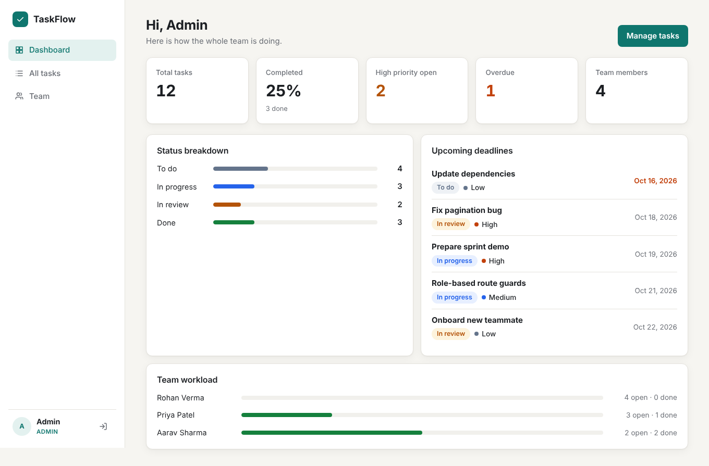
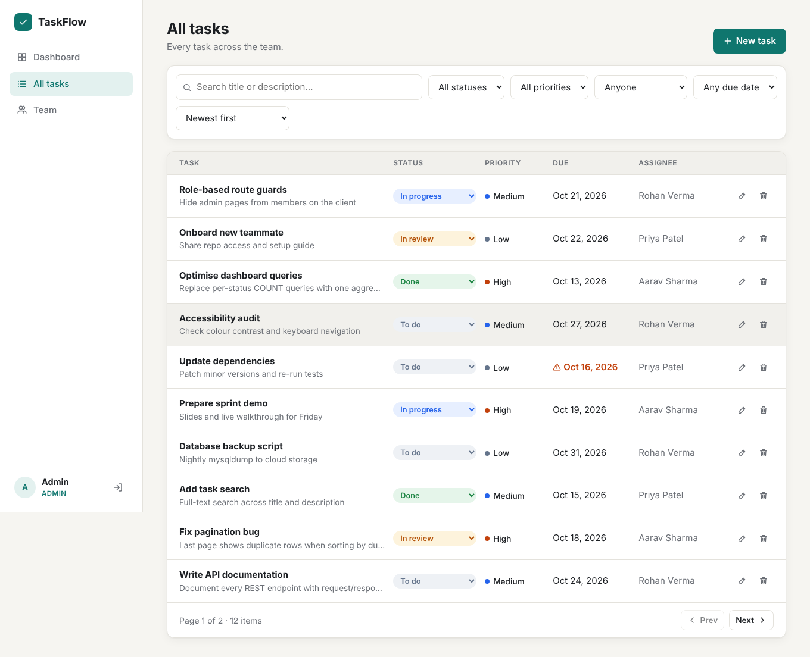
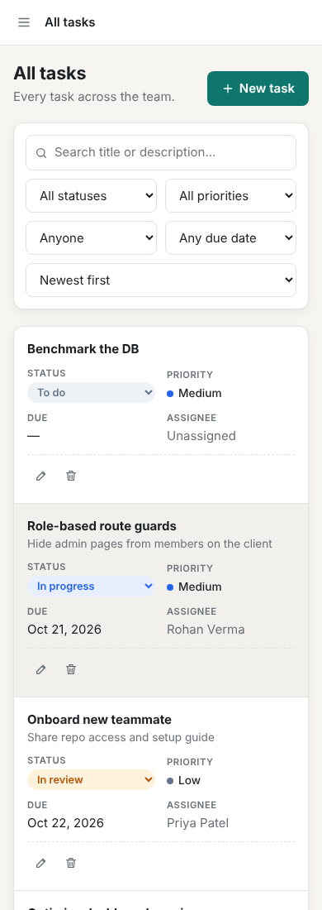

# TaskFlow: Full-Stack Task Management Web App

**React · Node.js · Express · MySQL · REST APIs · JWT**

TaskFlow is a responsive single-page app for small teams. **Admins** see the whole team's work, assign tasks and manage roles. **Members** see and update only the tasks they created or that are assigned to them.



---

## Features

| Area | What it does |
|---|---|
| **Authentication** | Register and log in with JWT, bcrypt-hashed passwords (cost 12), auto-logout when a token expires |
| **Role-based dashboards** | Admin dashboard shows team totals, status breakdown, workload per person and upcoming deadlines. Member dashboard shows the same metrics for the member's own tasks only |
| **Task tracking** | Create, edit and delete tasks, and change status inline (To do → In progress → In review → Done), with priority, due date and assignee |
| **Filtering & search** | Filter by status, priority, assignee and overdue. Full-text search (FULLTEXT index). Sort by date, due date, priority or title |
| **Pagination** | Server-side `LIMIT/OFFSET` paging. The page of rows and the total count are fetched in parallel |
| **Team management (admin)** | Search users, promote or demote roles, remove accounts |
| **Invite-only sign-up** | Optional `INVITE_CODE`: new users can only join with the code. Admins copy a ready-made invite link from the Team page (code compared in constant time) |
| **Security** | Input-sanitization middleware, express-validator rules, parameterized SQL, whitelisted `ORDER BY`, Helmet headers, rate limiting, CORS |
| **Error handling** | A single error handler, so every error comes back in the same JSON shape |
| **Responsive** | Sidebar layout on desktop. Off-canvas menu and card-style task list on phones |

<p>
  
  
</p>

---

## Tech stack

- **Frontend:** React 18, React Router 6, Vite, plain CSS (no UI library), hooks (`useState`, `useEffect`, `useContext`, `useCallback`, `useMemo`, `useRef`) plus the custom hooks `useTasks` and `useDebounce`
- **Backend:** Node.js, Express 4, mysql2 (connection pool), jsonwebtoken, bcryptjs, express-validator, helmet, express-rate-limit
- **Database:** MySQL 8 (InnoDB, foreign keys, composite and FULLTEXT indexes)

---

## Project structure

```
taskflow/
├── client/                    React SPA (Vite)
│   └── src/
│       ├── api/client.js        fetch wrapper: adds JWT, normalises errors
│       ├── context/             AuthContext (session), ToastContext (notifications)
│       ├── hooks/               useTasks (data + pagination), useDebounce (search)
│       ├── components/          Layout, ProtectedRoute, TaskList, TaskForm, Modal, Pagination…
│       ├── pages/               Login, Register, Dashboard, Tasks, Users, NotFound
│       └── styles/global.css    design tokens, light/dark, responsive breakpoints
├── server/                    REST API (Express)
│   ├── db/schema.sql            tables + indexes
│   ├── db/setup.js              creates DB, admin account, demo data
│   ├── scripts/benchmark.js     before/after query-performance benchmark
│   └── src/
│       ├── app.js               middleware pipeline + routes
│       ├── config/              env validation, MySQL pool
│       ├── middleware/          auth (JWT + roles), sanitize, validate, errorHandler
│       ├── controllers/         auth, tasks, users, stats
│       └── routes/              endpoint definitions + validation rules
└── docs/screenshots/
```

---

## Quick start

Full beginner instructions are in **[SETUP_GUIDE.md](SETUP_GUIDE.md)**.

```bash
# 1. install dependencies
npm run install:all

# 2. configure: copy server/.env.example to server/.env and fill in your values

# 3. create the database, admin user and demo data
cd server && npm run db:setup

# 4. run the API and the React app (two terminals)
cd server && npm run dev        # http://localhost:5000
cd client && npm run dev        # http://localhost:5173
```

Demo member accounts (created when `SEED_DEMO_DATA=true`): `aarav@taskflow.com`, `priya@taskflow.com`, `rohan@taskflow.com`, all with password `Member@123`.

---

## REST API

All endpoints are under `/api`. Protected endpoints need the header `Authorization: Bearer <token>`.

| Method | Endpoint | Access | Description |
|---|---|---|---|
| POST | `/auth/register` | public | Create a member account (needs `inviteCode` when `INVITE_CODE` is set), returns `{ user, token }` |
| POST | `/auth/login` | public | Returns `{ user, token }` |
| GET | `/auth/me` | logged in | Current user |
| GET | `/auth/config` | public | `{ inviteRequired }` for the sign-up page |
| GET | `/tasks` | logged in | List tasks (see query params below) |
| GET | `/tasks/:id` | logged in | One task |
| POST | `/tasks` | logged in | Create a task |
| PATCH | `/tasks/:id` | creator / assignee / admin | Partial update (assignees may change status only) |
| DELETE | `/tasks/:id` | creator / admin | Delete a task |
| GET | `/stats` | logged in | Dashboard numbers (team-wide for admins) |
| GET | `/users` | admin | Paginated user list with task counts |
| GET | `/users/options` | admin | `{id, name}` list for the assignee dropdown |
| GET | `/users/invite` | admin | The invite code to share with new teammates |
| PATCH | `/users/:id/role` | admin | `{ "role": "admin" \| "member" }` |
| DELETE | `/users/:id` | admin | Remove a user |
| GET | `/health` | public | Health check |

**`GET /api/tasks` query params:** `page`, `limit` (≤100), `status` (`todo` \| `in_progress` \| `review` \| `done`), `priority` (`low` \| `medium` \| `high`), `assignedTo` (`me` \| `unassigned` \| user id), `overdue=true`, `search`, `sortBy` (`created_at` \| `updated_at` \| `due_date` \| `priority` \| `title`), `order` (`asc` \| `desc`).

**Response shape**

```jsonc
// success
{ "success": true, "data": [ ... ], "meta": { "page": 1, "limit": 10, "total": 42, "totalPages": 5 } }
// error
{ "success": false, "error": { "code": "BAD_REQUEST", "message": "Validation failed",
  "details": [ { "field": "title", "message": "Title must be 3–150 characters" } ] } }
```

---

## Query performance

`npm run benchmark` (inside `server/`) builds a separate `taskflow_bench` database with 100,000 tasks. It then times the same API scenarios twice:

- **Before:** no secondary indexes, `SELECT *`, `LIKE '%term%'` search, one `COUNT` per status, and N+1 lookups for user names
- **After:** composite indexes that match the filter and sort patterns, a FULLTEXT index, a single aggregate query, JOINs, and only the columns the UI needs

Sample run (MySQL 8.0, 100k tasks, median of 15 runs):

| Scenario | Before | After | Reduction |
|---|---|---|---|
| Member task list (status filter, page 3) | 106 ms | 3.3 ms | 96.9% |
| Admin list (status + priority filter) | 84 ms | 3.6 ms | 95.8% |
| Keyword search | 204 ms | 98.9 ms | 51.5% |
| Member dashboard stats | 162 ms | 1.9 ms | 98.8% |
| Overdue tasks list | 90 ms | 17.5 ms | 80.6% |

Your numbers will vary by machine. Run the benchmark yourself to get them.

---

## Security notes

- **SQL injection:** every query uses `?` placeholders. Sort columns are taken from a whitelist and are never inserted from raw input.
- **XSS:** `middleware/sanitize.js` strips HTML tags and script blocks from all input. React also escapes output.
- **Prototype pollution:** `__proto__`, `constructor` and `prototype` keys are dropped from request bodies.
- **Brute force:** login and register are limited to 20 attempts per 15 minutes per IP. The global limit is 300 requests per minute.
- **Account enumeration:** a wrong email and a wrong password return the same message.
- **Authorization:** roles are re-checked against the database on every request, so a demoted or deleted user loses access immediately. Members get a 404 (not a 403) for other people's tasks.

---

## Deployment

The Express server also serves the built React app, so the whole project deploys as **one web service**. Step-by-step instructions for deploying to Render with a free Aiven MySQL database are in [SETUP_GUIDE.md](SETUP_GUIDE.md#part-6-optional-put-it-online).
